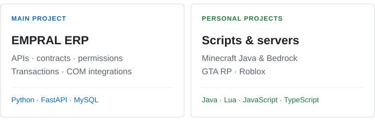

<picture>
  <source media="(prefers-reduced-motion: reduce) and (max-width: 600px) and (prefers-color-scheme: dark)" srcset="./assets/header-dark-en-mobile-static.svg">
  <source media="(prefers-reduced-motion: reduce) and (max-width: 600px) and (prefers-color-scheme: light)" srcset="./assets/header-light-en-mobile-static.svg">
  <source media="(prefers-reduced-motion: reduce) and (prefers-color-scheme: dark)" srcset="./assets/header-dark-en-static.svg">
  <source media="(prefers-reduced-motion: reduce) and (prefers-color-scheme: light)" srcset="./assets/header-light-en-static.svg">
  <source media="(max-width: 600px) and (prefers-color-scheme: dark)" srcset="./assets/header-dark-en-mobile.svg">
  <source media="(max-width: 600px) and (prefers-color-scheme: light)" srcset="./assets/header-light-en-mobile.svg">
  <source media="(prefers-color-scheme: dark)" srcset="./assets/header-dark-en.svg">
  <source media="(prefers-color-scheme: light)" srcset="./assets/header-light-en.svg">
  
</picture>

<picture>
  <source media="(prefers-color-scheme: dark)" srcset="./assets/typing-dark-en.svg">
  <source media="(prefers-color-scheme: light)" srcset="./assets/typing-light-en.svg">
  
</picture>

<strong>IT Analyst at EMPRAL</strong> · Previously at <strong>Hyundai Motor Brasil</strong>

I develop **ERP software, APIs and automation in Python**, using **MySQL and system integrations**. As a hobby, I develop **scripts, mods and game servers** — **Minecraft Java & Bedrock, GTA RP and Roblox**.

     

<a href="#games">Minecraft · GTA RP · Roblox</a> &nbsp; / &nbsp; <a href="#erp">ERP</a> &nbsp; / &nbsp; <a href="#experience">Experience</a> &nbsp; / &nbsp; <a href="#stack">Stack</a> &nbsp; / &nbsp; <a href="https://www.linkedin.com/in/brian-victor20/">LinkedIn</a> &nbsp; / &nbsp; <a href="./README.md">Português</a>

<picture>
  <source media="(max-width: 600px) and (prefers-color-scheme: dark)" srcset="./assets/focus-en-dark-mobile.svg">
  <source media="(max-width: 600px) and (prefers-color-scheme: light)" srcset="./assets/focus-en-light-mobile.svg">
  <source media="(prefers-color-scheme: dark)" srcset="./assets/focus-en-dark-desktop.svg">
  <source media="(prefers-color-scheme: light)" srcset="./assets/focus-en-light-desktop.svg">
  
</picture>

---

## Minecraft, GTA RP & Roblox

**Scripts · mods · interfaces · server setup and customization**

### Minecraft Java & Bedrock

**Current focus for new projects and side work.** I want to grow this area through server setup and customization for both editions.

### GTA RP

I've built **RP servers from scratch** and many scripts as a hobby, including interfaces and custom features. This is also a focus for new side projects.

### Roblox

Also part of my gaming hobby: **scripts and features for personal projects**.

**`Java` `Lua` `JavaScript` `TypeScript` `HTML / CSS`**

---

## ERP, APIs & automation / work

I develop **EMPRAL**, an ERP connecting **management, engineering and documents**. My work spans interfaces and business logic, **APIs built with FastAPI, MySQL queries, report automation and desktop integrations**, while evolving a **Delphi** legacy.

I also develop calculation and document-generation routines, alongside integrations with office tools and CAD/Inventor.

**`Python` `Tkinter / ttkbootstrap` `MySQL` `Delphi` `FastAPI`**

<strong>ERP modules and integrations</strong>

| Area | What I develop |
| :--- | :--- |
| Management | Customers, quotations, work orders and time tracking. |
| Finance | Expenses, travel, reimbursements and cash reports. |
| Documents | Digital folders, drawings, revisions and PDFs. |
| Engineering | Calculations and reports for mills, feeding tables and conveyors. |

I also work on Outlook and CAD/Inventor integrations, under development and feature-specific validation. Some steps depend on the target Windows environment.

## Experience / IT since 2022

**Piracicaba, São Paulo · Brazil**

### EMPRAL · IT Analyst

**Jan. 2024 — present**

System development and evolution in Delphi and, in the current project, Python, APIs and integrations. Leading process improvements, managing and negotiating technology tools, and supporting employee training.

### Hyundai Motor Brasil · IT Intern

**Feb. 2022 — Dec. 2023**

Process automation with **Power Automate** and control and cost dashboards in **Power BI**. Analysis and tracking of licenses, purchasing and inventory through **SAP**, alongside procedure reviews and IT process improvements.

<strong>Education, courses and knowledge</strong>

- **MBA in Project Management and Agile Methodologies** — PUC · 2024–2025.
- **Degree in Systems Analysis and Development** — UNINOVE · 2021–2023.
- **Secondary education with a professional qualification in Administration, Finance and Marketing Assistance** — ETEC Piracicaba · 2018–2020.

**Courses and knowledge:** PL-900 — Power Platform Fundamentals; intermediate Power BI; intermediate English; programming logic.

## Stack / where I use it

### Game scripts and interfaces

     

Script logic, features and interfaces in game-related projects.

### ERP, data and desktop tools

   

Python, Tkinter/ttkbootstrap and MySQL in the ERP; FastAPI for services and integrations; C# in desktop tools and add-ins.

### Automation & data analysis

**`Power Automate` `Power BI` `SAP`**

Process automation, dashboards and information tracking in corporate workflows.

<strong>Development environment</strong>

   

Git, GitHub and VS Code, with Windows desktop development.

---

ERP, automation and data at work. Scripts, mods and games as a hobby. <a href="https://www.linkedin.com/in/brian-victor20/">LinkedIn</a> · Current projects are kept in private repositories. <a href="./NOTICE.md">Visual credits</a> · <a href="./README.md">Português</a>

