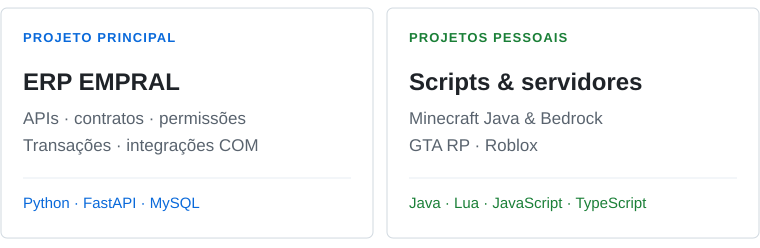

<picture>
  <source media="(prefers-reduced-motion: reduce) and (max-width: 600px) and (prefers-color-scheme: dark)" srcset="./assets/header-dark-mobile-static.svg">
  <source media="(prefers-reduced-motion: reduce) and (max-width: 600px) and (prefers-color-scheme: light)" srcset="./assets/header-light-mobile-static.svg">
  <source media="(prefers-reduced-motion: reduce) and (prefers-color-scheme: dark)" srcset="./assets/header-dark-static.svg">
  <source media="(prefers-reduced-motion: reduce) and (prefers-color-scheme: light)" srcset="./assets/header-light-static.svg">
  <source media="(max-width: 600px) and (prefers-color-scheme: dark)" srcset="./assets/header-dark-mobile.svg">
  <source media="(max-width: 600px) and (prefers-color-scheme: light)" srcset="./assets/header-light-mobile.svg">
  <source media="(prefers-color-scheme: dark)" srcset="./assets/header-dark.svg">
  <source media="(prefers-color-scheme: light)" srcset="./assets/header-light.svg">
  
</picture>

<picture>
  <source media="(prefers-color-scheme: dark)" srcset="./assets/typing-dark.svg">
  <source media="(prefers-color-scheme: light)" srcset="./assets/typing-light.svg">
  
</picture>

<strong>Analista de TI na EMPRAL</strong> · Experiência anterior na <strong>Hyundai Motor Brasil</strong>

Desenvolvo **ERP, APIs e automações em Python**, com **MySQL e integrações entre sistemas**. Por hobby, desenvolvo **scripts, mods e servidores de jogos** — **Minecraft Java & Bedrock, GTA RP e Roblox**.

     

<a href="#jogos">Minecraft · GTA RP · Roblox</a> &nbsp; / &nbsp; <a href="#erp">ERP</a> &nbsp; / &nbsp; <a href="#experiencia">Trajetória</a> &nbsp; / &nbsp; <a href="#stack">Stack</a> &nbsp; / &nbsp; <a href="https://www.linkedin.com/in/brian-victor20/">LinkedIn</a> &nbsp; / &nbsp; <a href="./README.en.md">English</a>

<picture>
  <source media="(max-width: 600px) and (prefers-color-scheme: dark)" srcset="./assets/focus-pt-dark-mobile.svg">
  <source media="(max-width: 600px) and (prefers-color-scheme: light)" srcset="./assets/focus-pt-light-mobile.svg">
  <source media="(prefers-color-scheme: dark)" srcset="./assets/focus-pt-dark-desktop.svg">
  <source media="(prefers-color-scheme: light)" srcset="./assets/focus-pt-light-desktop.svg">
  
</picture>

---

## Minecraft, GTA RP & Roblox

**Scripts · mods · interfaces · criação e personalização de servidores**

### Minecraft Java & Bedrock

**Foco atual para novos projetos e serviços extras.** Quero ampliar essa frente com criação, configuração e personalização de servidores nas duas edições.

### GTA RP

Já construí **servidores de RP do zero** e muitos scripts por hobby, incluindo interfaces e personalização de funcionalidades. Também está no meu foco para novos projetos extras.

### Roblox

Também faz parte da minha frente de hobby com jogos: **scripts e funcionalidades para projetos pessoais**.

**`Java` `Lua` `JavaScript` `TypeScript` `HTML / CSS`**

---

## ERP, APIs & automação / trabalho

Desenvolvo o **EMPRAL**, um ERP que conecta **gestão, engenharia e documentos**. O trabalho vai das interfaces e regras de negócio às **APIs com FastAPI, consultas MySQL, automação de relatórios e integrações desktop**, com evolução de um legado **Delphi**.

Também crio rotinas de cálculo e geração de documentos, além de integrações com ferramentas de escritório e CAD/Inventor.

**`Python` `Tkinter / ttkbootstrap` `MySQL` `Delphi` `FastAPI`**

<strong>Conhecer os módulos e as integrações do ERP</strong>

| Área | O que desenvolvo |
| :--- | :--- |
| Gestão | Clientes, orçamentos, ordens de serviço e apontamento de horas. |
| Financeiro | Despesas, viagens, reembolsos e relatórios de caixa. |
| Documentos | Pastas digitais, desenhos, revisões e PDFs. |
| Engenharia | Cálculos e relatórios para moendas, mesas alimentadoras e transportadores. |

Também trabalho em integrações com Outlook e ferramentas CAD/Inventor, com desenvolvimento e validação por recurso. Algumas etapas dependem do ambiente Windows de destino.

## Experiência / TI desde 2022

**Piracicaba, São Paulo · Brasil**

### EMPRAL · Analista de TI

**Jan. 2024 — atual**

Desenvolvimento e evolução de sistemas em Delphi e, no projeto atual, Python, APIs e integrações. Condução de melhorias em processos, gestão e negociação de ferramentas tecnológicas e capacitação de colaboradores.

### Hyundai Motor Brasil · Estagiário de TI

**Fev. 2022 — dez. 2023**

Automação de processos com **Power Automate** e dashboards de controle e custos no **Power BI**. Análise e controle de licenças, compras e estoque via **SAP**, além de revisão de procedimentos e melhorias nos processos de TI.

<strong>Formação, cursos e conhecimentos</strong>

- **MBA em Gestão de Projetos e Metodologias Ágeis** — PUC · 2024–2025.
- **Tecnologia em Análise e Desenvolvimento de Sistemas** — UNINOVE · 2021–2023.
- **Ensino Médio com qualificação de Auxiliar em Administração, Finanças e Marketing** — ETEC Piracicaba · 2018–2020.

**Cursos e conhecimentos:** PL-900 — Fundamentos da Power Platform; Power BI intermediário; inglês intermediário; lógica de programação.

## Stack / onde uso

### Scripts e interfaces para jogos

     

Lógica de scripts, funcionalidades e interfaces nos projetos ligados a jogos.

### ERP, dados e ferramentas desktop

   

Python, Tkinter/ttkbootstrap e MySQL no ERP; FastAPI em serviços e integrações; C# em ferramentas e complementos desktop.

### Automação & análise de dados

**`Power Automate` `Power BI` `SAP`**

Automação de processos, dashboards e controle de informações na rotina corporativa.

<strong>Ambiente de desenvolvimento</strong>

   

Git, GitHub e VS Code, com desenvolvimento desktop em Windows.

---

ERP, automação e dados no trabalho. Scripts, mods e jogos por hobby. <a href="https://www.linkedin.com/in/brian-victor20/">LinkedIn</a> · Projetos atuais em repositórios privados. <a href="./NOTICE.md">Créditos visuais</a> · <a href="./README.en.md">English</a>

